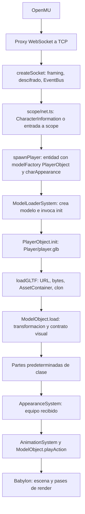
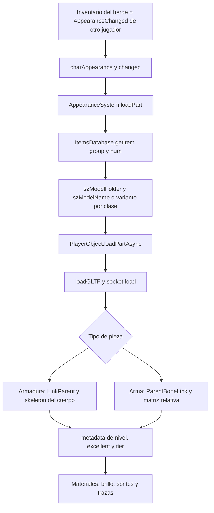

# MU Legacy Evolution: auditoria de arquitectura

Fecha: 2026-10-25. Alcance: Fase 0, inspeccion estatica del cliente local.
Commit inspeccionado: `6d3cbf9913126d2835feb7077937a25c40761e07`.
Git estaba limpio en `main`; esta documentacion se prepara en
`docs/architecture-audit`, sin commits automaticos. OpenMU no se modifica.

## Conclusion

Nota de implementacion posterior: el prototipo usa seleccion explicita del GLB
mediante `visualBody` junto a `visualProfile=evolution`. La propuesta inicial de
ruta fija que se describe mas abajo se reemplazo para no referenciar un archivo
inexistente. Ver [pipeline actual](custom_asset_pipeline.md) y
[revision contrastada](override_review.md).

Ignies ya usa GLB en ejecucion. No hace falta agregar otro cargador ni convertir
el protocolo. `PlayerObject` carga un rig de MU y compone el cuerpo con piezas
separadas. Un GLB humanoide arbitrario no es intercambiable con ese contrato:
materiales, pesos, ejes, indices de clips y huesos tienen tratamiento especifico.

La primera prueba de menor riesgo es sustituir una pieza visual del cuerpo por
un GLB original compatible con el rig existente, manteniendo su animacion y
equipamiento. Eso valida el override, pero no demuestra soporte para un skeleton
nuevo. Un humanoide con rig propio necesita una segunda propuesta acotada de
adaptacion de animaciones, sockets y consumidores de huesos.

## Mapa de archivos y simbolos

Las rutas son relativas a la raiz de este repositorio. Los enlaces apuntan al
codigo inspeccionado; los numeros de linea son referencias de esta revision.

| Responsabilidad | Archivo y punto concreto |
| --- | --- |
| Motor | [`createEngine`](../src/controllers/render/babylon/utils.ts), linea 129 |
| Escena | [`TestScene extends Scene`](../src/controllers/render/scenes/testScene.ts), linea 21; configuracion de pases en `src/controllers/render/scenes/` |
| Mundo ECS y sistemas | [`createWorld`](../src/ecs/createWorld.ts), linea 188; componentes en [`world.ts`](../src/ecs/world.ts) |
| Mapa y terreno | [`loadMapIntoScene.ts`](../src/controllers/terrain/loadMapIntoScene.ts), [`mapTerrain.ts`](../src/controllers/terrain/mapTerrain.ts); registro en [`maps/index.ts`](../src/controllers/maps/index.ts) |
| Limpieza al cambiar mapa | [`resetForMapChange`](../src/app/lifecycle.ts), linea 34 |
| Transporte | [`createSocket`](../src/controllers/net/sockets/createSocket.ts); puente WebSocket/TCP en `proxy/` |
| Entrada de personajes | [`spawnPlayer`](../src/modules/scope/net.ts), linea 27; `addCharacterToScope`, linea 217; `spawnHeroOnJoin`, linea 377 |
| Entrada de monstruos/NPC | [`addNpcToScope`](../src/modules/scope/objects.ts), linea 65; [`resolveModelFactory`](../src/controllers/actors/modelFactoryPerId.ts) |
| Creacion visual | [`createModelObject`](../src/ecs/systems/modelLoaderSystem.ts): crea `entity.modelFactory`, asigna clase e invoca `init` |
| Personaje compuesto | [`PlayerObject`](../src/controllers/actors/playerObject.ts): `init`, linea 254; `setBodyPartsAsync`, linea 471; `loadPartAsync`, linea 521 |
| Clase de red a modelo | [`MapPlayerNetClassToModelClass`](../src/controllers/actors/mapPlayerNetClassToModelClass.ts) |
| Apariencia recibida | [`deserializeAppearance.ts`](../src/controllers/actors/deserializeAppearance.ts); `applyAppearanceChange` en `scope/net.ts`, linea 323 |
| Apariencia del heroe | [`Hero.syncPlayerAppearance`](../src/modules/hero/state.ts), linea 237 |
| Equipar piezas | [`AppearanceSystem`](../src/ecs/systems/appearanceSystem.ts), `loadPart` y aplicacion de sockets |
| Definiciones de items | [`ItemsDatabase`](../versions/shared/items/itemsDatabase.ts); contenido en `versions/shared/items/` |
| Armas y sockets | [`weaponAttachment.ts`](../src/controllers/actors/weaponAttachment.ts), huesos 33, 42 y 47; [`boneLink.ts`](../src/controllers/render/boneLink.ts) |
| Modelo comun | [`ModelObject`](../src/controllers/render/modelObject.ts): `playAction`, linea 925; `load`, linea 1154; enlace de hueso alrededor de 1861; `Unload`, linea 2007; `dispose`, linea 2033 |
| Carga y cache GLB | [`modelLoader.ts`](../src/controllers/assets/modelLoader.ts): `prepareMeshes`, linea 499; `loadContainerBytes`, linea 613; `loadGLTF`, linea 750; `disposeLoadedModel`, linea 872 |
| URLs y raices | [`assetUrl` y `resolveUrlToDataFolder`](../src/controllers/assets/resolveUrlToDataFolder.ts) |
| Clips por instancia | [`lazyAnimationGroups.ts`](../src/controllers/assets/lazyAnimationGroups.ts) |
| Animaciones | [`AnimationSystem`](../src/ecs/systems/animationSystem.ts), [`playSpeed.ts`](../src/controllers/anim/playSpeed.ts), [`playerActionMapper.ts`](../src/controllers/anim/playerActionMapper.ts) |
| Eleccion de postura | [`weaponClass.ts`](../src/controllers/actors/weaponClass.ts), `chooseIdleAction`, `chooseWalkAction`, `chooseRunAction`, `chooseAttackAction` |
| Muerte | [`deathSystem.ts`](../src/ecs/systems/deathSystem.ts) |
| Brillo de equipo | [`itemGlowSystem.ts`](../src/ecs/systems/itemGlowSystem.ts), [`itemVisualTier.ts`](../src/controllers/item_fx/itemVisualTier.ts) |
| BMD | [`assets/bmd/index.ts`](../src/controllers/assets/bmd/index.ts), lectores `assets/mu/`; conversion offline en [`tools/bmdToGlb.ts`](../tools/bmdToGlb.ts) |

## Flujo de personaje

`spawnPlayer` establece `modelFactory: PlayerObject`, estado de apariencia y
componentes de entidad. `ModelLoaderSystem` transforma la clase de red mediante
`MapPlayerNetClassToModelClass` antes de inicializar el modelo. El heroe puede
crearse con `CharacterInformation` aunque no llegue una entrada propia a scope.

`PlayerObject.init` carga `Player/player.glb`, pone temporalmente `Ready = false`,
carga las partes de clase y finalmente marca `Ready = true`. El rig no contiene
el cuerpo visible completo: carga `HelmClass`, `ArmorClass`, `PantClass`,
`GloveClass` y `BootClass` con sufijo de clase. Por eso cambiar solamente
`Player/player.glb` no sustituye todo el personaje.

`loadGLTF` resuelve la raiz de assets de la version, descarga bytes y parsea un
contenedor. Comparte geometria y materiales, clona nodos y skeleton y obtiene
clips de forma diferida cuando puede mapear sus destinos. El primer clip se
reproduce y se posiciona en su frame inicial. El rig sin meshes tiene un caso
especial: `synthesizeRigSkeleton` si la ruta contiene `player.glb`.

`ModelObject.load` aplica posicion, escala `(1,-1,1)` y rotacion X de -90 grados.
Estas correcciones pertenecen al pipeline convertido de MU; un GLB exportado de
Blender con convenciones normales necesita normalizacion explicita.

Para monstruos y NPC, `addNpcToScope` consulta `resolveModelFactory`. Hay clases
registradas y factories genericas de monstruo, NPC, equipo y transformaciones.
El registro de contenido ya proporciona extensibilidad sin condicionales por
tipo dentro del motor. No todos esos cuerpos son `PlayerObject`.

## Animaciones y tiempo

`AnimationSystem` usa estado de movimiento, armas, montura y acciones para
seleccionar `PlayerAction`. `ModelObject` y consumidores acceden directamente a
`gltf.animationGroups[CurrentAction]`: los clips no se resuelven por nombres
universales como Idle o Walk. La muerte tiene su propio sistema.

Las velocidades provienen de tablas de MU: 25 ticks de referencia y clips
convertidos a 24 keys/s. Ataques, habilidades y efectos pueden consultar frames,
duracion o huesos concretos. Un adaptador debe conservar el identificador logico
y la semantica temporal; mapear seis nombres de animacion no basta para afirmar
compatibilidad de todas las habilidades.

Los tests existentes incluyen `anim.golden.test.ts`, `playSpeed.test.ts`,
`modelObject.test.ts`, `modelLoader.test.ts`, `lazyAnimationGroups.test.ts`,
`playerObject.test.ts`, `appearanceSystem.test.ts` y pruebas de scope.

## Flujo de equipamiento

La apariencia del heroe procede del inventario mediante
`Hero.syncPlayerAppearance`; la de otros jugadores, de scope y sus actualizaciones.
Los IDs de items se conservan. `loadPart` aplica variantes por clase y reglas
especiales antes de llamar a `loadPartAsync`. Las armas usan sockets `Weapon1`
y `Weapon2`; las armaduras usan `HelmMask`, `Armor`, `Pants`, `Gloves` y `Boots`.

Con `LinkParent`, `ModelObject.load` reasigna el skeleton de los meshes al del
padre y detiene los clips propios de la pieza. Eso exige compatibilidad real de
indices de joints y bind poses. Las armas usan indices MU 33/42, espalda 47 y
matrices en coordenadas BMD; el acceso final usa `bones[ParentBoneLink + 1]`.
Alas, capas, pets y algunas armas tienen excepciones existentes que deben
permanecer en el recorrido clasico.

`loadPartAsync` usa `loadSeq` para evitar aplicar una respuesta vieja y
`PartsPending` para la pantalla de carga. Un resultado descartado por secuencia
sale antes de `part.load`; conviene comprobar su liberacion en una futura prueba
de cargas concurrentes, sin ampliar esta auditoria a una limpieza general.

## Dependencias y restricciones

Segun `package.json`: Babylon core/loaders/materials 7.51.1, TypeScript 5.8.3,
Vite 5.3.5, Vitest 2.1.9, React 18.3.1, Miniplex 2.0.0 y Bun para herramientas.
Son versiones declaradas; no se ha comprobado aqui la resolucion de cada paquete.
`render/babylon/exports.ts` ya registra el loader glTF 2.0 y decodificadores.

El cargador actual fuerza extension `.glb` y entrega bytes como archivo binario.
No dar por demostrado soporte de `.gltf` con buffers/texturas externos aunque
Babylon tenga el plugin. Para el primer experimento usar GLB autocontenido.

Las dependencias apuntan de app a contenido, modulos, controladores y core.
Los controladores no importan contenido ni modulos. Una configuracion de contenido
debe entregarse mediante registro o hook, no mediante import inverso. Los cambios
visuales nuevos deben ser optativos y preservar el recorrido Classic. Los
creditos y su acceso se conservan segun `AGENTS.md` y la licencia del proyecto.

## Riesgos tecnicos concretos

| Riesgo | Evidencia y tratamiento propuesto |
| --- | --- |
| Deformacion de humanoide nuevo | `prepareMeshes` fuerza `numBoneInfluencers = 1`; preservar multiples pesos en una politica de carga custom separada |
| Materiales PBR alterados | `prepareMeshes` cambia materiales con albedo por materiales MU y elimina el original; un modo custom debe preservar el contrato PBR deliberadamente |
| Modelo girado o reflejado | `ModelObject.load` normaliza segun BMD; definir espacio de autor y conversion, no corregir a ojo por asset |
| Arma en hueso incorrecto | Sockets con indices MU y desplazamiento +1; un rig nuevo requiere mapa semantico de sockets |
| Equipo deformado | Reasignacion directa de skeleton no hace retargeting; exportar piezas compatibles o preparar equipo propio |
| Animacion o efectos desincronizados | Clips por ID y temporizacion en frames; conservar acciones logicas y auditar habilidades usadas en la prueba |
| Efectos con huesos MU | `deathSystem`, `headTrackingSystem`, `guildFlagSystem`, `weaponTrailSystem` y habilidades consultan bones concretos; adaptar o usar fallback explicito por capacidad |
| URL inesperada | `assetUrl` antepone raiz de version incluso a `/assets/custom/...`; usar ruta relativa a esa raiz en el primer prototipo |
| Cache incompatible | Contenedores indexados por ruta; si se agrega politica legacy/custom, incluirla en la clave y evitar mezclar preparaciones |
| Fugas o respuesta tardia | Conservar `disposed`, secuencias, liberacion de clones/skeleton/clips y eviction; probar destruccion durante carga |
| Error deja actor inutilizable | Ya hay `LoadFailed` y placeholder para entidades de red; un override debe intentar legacy antes de ese ultimo recurso |

`disposeLoadedModel`, `ModelObject.Unload` y `dispose` ya liberan recursos de
instancia. Los contenedores mantienen recursos compartidos. `evictContainers`
elimina carpetas de mapa y `evictUnusedContainers` modelos sin uso con periodo
de gracia. No disponer texturas/materiales compartidos desde una sola entidad.

## Propuesta minima y archivos exactos

Decision propuesta, pendiente de implementacion: primer override de una pieza de
cuerpo compatible con el rig MU. Configuracion de desarrollo optativa, seleccion
por `PlayerClass` real y slot, sin usar un `characterId` o nombre `warrior`
inventado. El resultado visual conserva los items y reglas del servidor.

1. Resolver ruta alternativa antes de cargar una parte predeterminada de clase.
2. Reutilizar `loadGLTF`, cache y `loadPartAsync`; no crear un segundo loader.
3. Reutilizar `devQuery` para activar un perfil local y fijo, sin nueva dependencia.
4. Si falla el override, registrar el motivo y cargar la ruta legacy original.
5. Desactivar el perfil restaura el recorrido existente al recrear el personaje.
6. Mantener equipamiento normal: una armadura equipada puede cubrir o sustituir
   la pieza custom. Esa es una limitacion explicita del prototipo.

Lista cerrada propuesta para esa prueba, no modificada en esta fase:

| Archivo | Cambio |
| --- | --- |
| `src/controllers/actors/visualOverrides.ts` (nuevo) | Resolver puro clase/slot/perfil y contrato de pieza compatible |
| `src/controllers/actors/visualOverrides.test.ts` (nuevo) | Sin perfil, clase distinta, override y configuracion invalida |
| `src/controllers/actors/playerObject.ts` | Aplicar resolver a piezas predeterminadas y fallback dentro del flujo existente |
| `src/controllers/actors/playerObject.test.ts` | Desactivado conserva rutas; fallo vuelve a legacy; destruccion durante carga |
| `src/controllers/actors/readme.md` | Documentar contrato, activacion y limites |
| `public/game-assets/Custom/evolution_body.glb` (nuevo) | Pieza original compatible; aportar origen y licencia antes de integrarla |
| `docs/custom_asset_pipeline.md` (nuevo) | Perfil de desarrollo, procedencia del asset y verificacion manual |

La raiz publica final debe confirmarse contra `gameVersion.data.assets` de la
sesion antes de colocar el archivo; `Custom/evolution_body.glb` es la ruta logica
propuesta. El GLB aun no existe ni ha sido seleccionado.

Para un humanoide con rig independiente habria que ampliar el diseno: politica
custom en `assets/modelLoader.ts`, normalizacion en `render/modelObject.ts`,
adaptacion de acciones/frames y sockets, factories del cuerpo y tratamiento de
`AppearanceSystem`. No presento esa ampliacion como un reemplazo de ruta de bajo
riesgo: requiere validar primero un GLB y enumerar sus capacidades. No se
propone modificar OpenMU, paquetes de red, inventario o calculos de combate.

## Validacion y limites de la Fase 0

Esta fase produce documentacion y no implementa overrides. La jugabilidad actual
es informacion del usuario; login, crafting, bots y combate no se han verificado
manualmente en esta auditoria. Tampoco se ha certificado un GLB original.

Comandos disponibles para la implementacion posterior: `bun run tsc`,
`bun run test`, `bun run test:server`, `bun run check`, `bun run check:lint` y
`bunx vite build`. Build completo de distribucion: `bun run build`, que ademas
copia y procesa assets. Desarrollo: `bun run dev` y `bun run proxy` segun README.

La futura regresion debe cubrir login, seleccion, movimiento, animaciones,
combate, monstruos/bots, inventario, equipar/desequipar, drops y crafting; con
perfil activo e inactivo, fallo de URL, cambio de mapa y recreacion repetida.
Medir meshes, skeletons y grupos tras ciclos de carga, respetando la cache que
deliberadamente permanece caliente. Los checks de documentacion ejecutados y
sus resultados se registran al cerrar esta fase.
